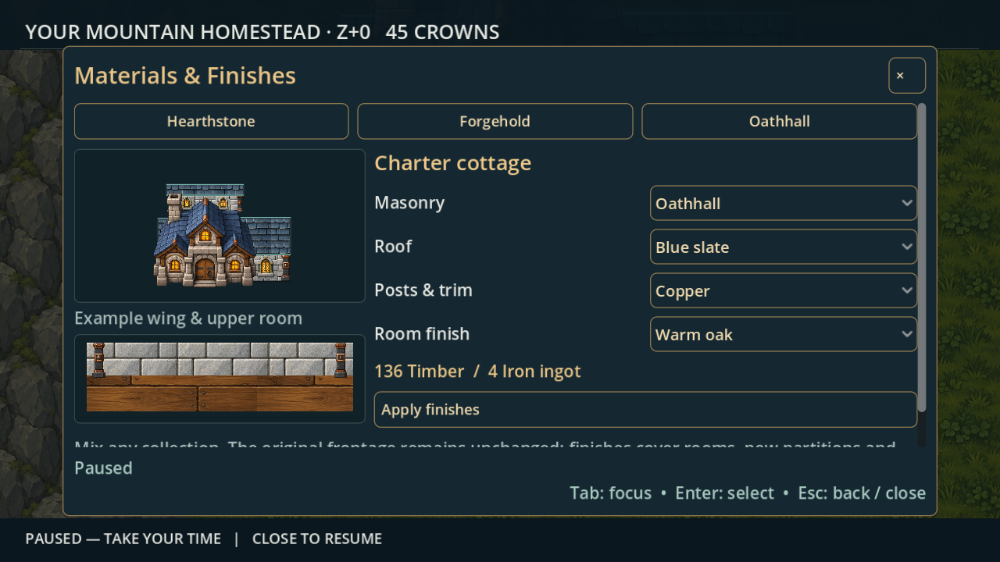
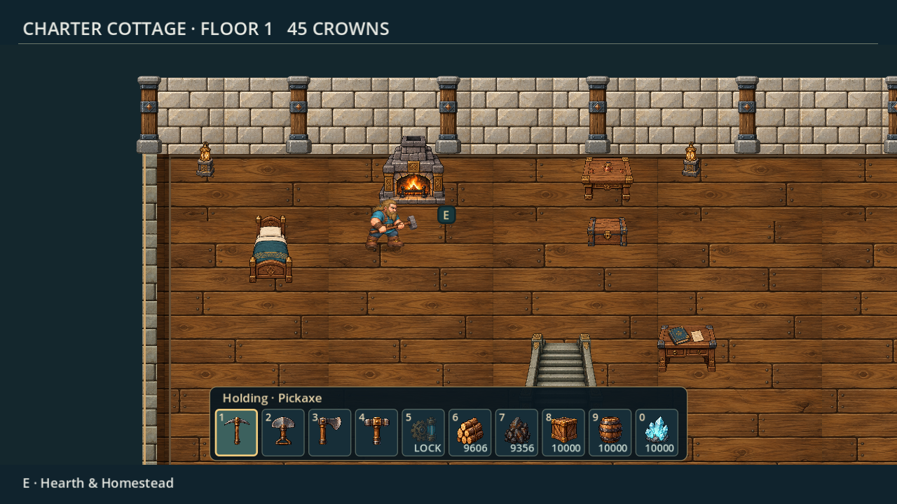

# Architecture collections 87 — native and release acceptance

## Scope

Three compatible collections; independent masonry/roof/trim/floor choices; original fronts retained intact; proportional side/rear annexes and set-back upper storeys; painted interior floors/walls; visual building/furniture/structure catalogues; saved, quoted refinishing. Existing room dimensions, route/collision rules, furniture/chest identity and normal/test-save separation remain.

## Native checks

Run `architecture-style-preview` through tools/check.py with an isolated native display. The test drives real catalogue and selector controls, constructs and extends a cottage, verifies source-art/scale preservation, previews and applies pure/mixed collections, checks prices/no-op/insufficient-material/unknown-choice transactions, preserves furnishings and stored crystal through reload, builds/removes a real partition, adds all five floors, and checks viewport/horizontal fit for the menus. Legacy records and freeform collection saves are covered.

`architecture87-final` passed 60 checks with zero engine errors. `architecture87-regression` passed architecture86 (301), menus (9), homestead (69), royal (72) and modular (28): 479 checks. Total final focused checks: 539. See architecture87/native-results.json. The first collection probe correctly rejected a fixture partition within 85px of the stairs; the fixture now builds in the clear expanded wing. Its storage assertion now targets the actual private chest ID, coordinates and seven stored crystals rather than comparing unrelated world chests and JSON number types.

Reviewed native plan cards, furniture groups, material studies, mixed choices, five-storey silhouette, oak/basalt/granite rooms and retained original fronts. The final run includes window-card, room-study and initial-action visibility refinements. The external full-front capture uses an inspection camera; the normal camera is unchanged.

## Required gates

- Focused regression: architecture, menus, homestead, royal, modular.
- Full source: all 31 gameplay cases plus people-preview.
- Exact Windows PCK: all 21 cases, including architecture86 and architecture87.
- Verify clean source/build metadata and uploaded archive size/SHA256 before delivery.

Runtime source 52e90de84fe2df330347fefbee98825cba1d96c3 and PR #45 merge ce49bfe6b68383a28ae8f5304113b8eac28eb67f have identical tree 19a8d8b9d23d5dba33a4bb1c221aeca49ac87cda. Source run 40261718443 passed all 31 gameplay cases plus hosted people-preview. Release run 40261717625 passed all 21 exact-export cases: 1,610 assertions, including all 60 architecture87 checks. The published v0.77.0 tag points to the verified runtime. Exported mixed-material and Hearthstone/Oathhall room captures were reviewed.

The downloaded build report and verification archive match their GitHub SHA256 digests. The clean report, tag and uploaded ZIP metadata agree: 733,838,675 bytes, SHA256 c4b874b7fc401afd597672a44fd8d39c60cf87aeb80491f843d620b4f54ad1b5. See architecture87/source-results.json, pack-results.json, hosted-build.json and delivery.json. Full exported captures remain in the release verification-evidence.tar.gz asset. Windows-device frame rate, audio and subjective player preference remain hands-on testing. Passing assertions alone do not establish visual quality.

## Recovery and controls

Pre-edit master: f62bf8fcfeccd5b47cfab0ac61c741911777860a. Local pre-architecture87 tag and verified architecture87-before.bundle retain it; the incremental bundle requires ff840c816d451e75babaf1fecdc3c776c8b8a1e2 and 94321816d2c0097514b11269e8f6a5fb95f4e25d, retained in previous backups. Remote recovery/pre-architecture87 is confirmed. Preserve all older bundles, recovery branches and releases.

Title → Dev Testing → Construction & decorating → F9 → eastern grounds; reopen F9 for Building Book. In normal play, O on the claim opens home improvements; inside a built room it opens renovation. Materials & finishes previews changes before Apply. Full façades remain signature components; arbitrary exterior window placement and NPC business assignments are future scope.

## Native visual evidence

