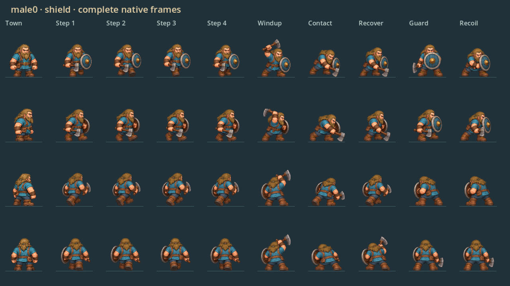
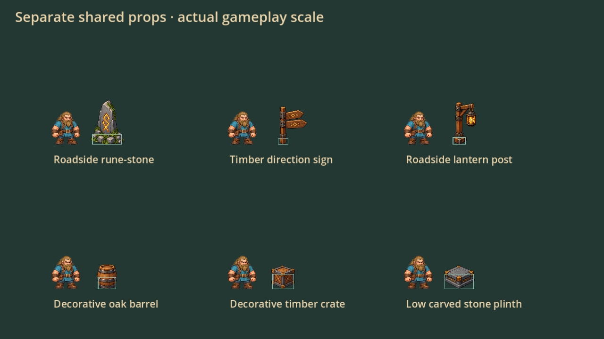

# Combat equipment and separated props 88 — native and release acceptance

## Scope

Axe-and-shield combat uses complete equipped drawings for all fourteen saved identities. Idle, walking, strike, guard and block reaction retain their equipment and painted grip. Practice Borin uses the same poses. Eight original hammer crops now include the complete connected hammer head. The original PNGs, saved identities and palettes are preserved. No damage, hitbox or attack-timing changes are included.

Rune-stones, signs, lantern posts, barrels, crates and plinths are separate catalogue items, each with its own payment, placement, physical base and recovery. Outdoor signs are depth-sorted beside travel thresholds. World arrangements and player construction share the same drawings. Barrels and crates are explicitly decorative.

## Native acceptance

Run `combat-art-preview` or `combat-art-regression` through tools/check.py using an isolated native display and fresh test saves. The dedicated case checks all identities and directional equipped selections, constant body scale, complete hammer crops, live guard/recoil/attack transitions, six individual placement transactions, collision, real save/reload, independent movement/recovery, catalogue fit and clear travel approaches.

The final dedicated case passed 123 assertions with zero engine errors. Focused regression cases passed combat (31), enemies (96), developer testing (40), roads (80), appearance (64) and architectural collections (60): 494 unique focused assertions in total. See combat88/native-results.json. Initial fixture errors compared JSON numeric types and checked the wrong furnishing record key; these were corrected before acceptance. No game failures were hidden by those fixture changes.

All fourteen native shield contact sheets and existing hammer/carbine boards were reviewed. Native practice contact, guard/recoil, roadside arrangements, individual props and catalogue cards were also reviewed at gameplay scale. This caught clipped original hammer heads and incorrect generated facing keys, which were repaired or excluded. See assets/combat88/PRODUCTION.md for exact source selection and acknowledged artwork limitations.

An additional input-driven probe captured 396 native frames while moving, holding LMB, holding RMB and resuming attacks with male0/female3 axe and hammer loadouts. Its trace includes equipped idle, strikes, raised guard and live shield recoil. Selected transition frames were reviewed. The probe and trace are retained here for reproduction; this is not a claim of manual Windows playtesting or audible review.

## Delivery gates

Runtime source: b2ce75a095c6aefe801b1cdb46f648448e40253d. Tree: 9575060eb5e44fbaeab8d0784f0210f1803f89e1. Runtime PR: #47. Source run: 40334541809. Release run: 40334541656.

All 32 source cases and people-preview passed. All 22 exact-export cases passed, with 1,733 assertions. PR #47 merged as fe060bf55202a59011ac30ae8fbdbc3f0cb00f94 with the same runtime tree. Published v0.78.0 points to the verified source commit. All 29 native/exported character and prop boards are byte-identical. Exported male0 shield, female3 hammer, separate props and practice recoil captures were reviewed.

The downloaded build report and verification archive match their GitHub digests. The clean report, release tag and uploaded Windows ZIP metadata agree: 767,100,400 bytes, SHA256 583a5e070dddad84854d2ac747f9edc1a2a1fea6528d39dfde43f450d8295cb3. See combat88/source-results.json, pack-results.json, hosted-build.json and delivery.json. Full exported evidence remains in the release verification-evidence.tar.gz asset. The ZIP itself was not redownloaded locally; its uploaded digest and byte count were checked against the verified build report.

## Recovery and controls

Baseline master 32822157cc76f4f2f954bad7d848794adab8456a remains on recovery/pre-combat88. The new source is retained on recovery/combat88-native-verified and in the verified local combat88-published-native-verified.bundle. That incremental bundle requires the baseline. Preserve the earlier native/hammer checkpoints and all older releases and recovery branches.

Title → Dev Testing → Combat arena. B chooses equipment; hold LMB to strike, RMB to guard, Q to dodge. For decor: Dev Testing → Construction & decorating → F9 → Building book → Furniture & details → Roadside. Place, move and recover pieces separately using the existing furnishing controls.

Rear guard/recoil sometimes share one braced drawing. Horizontal mirroring retains apparent-handedness limitations. Original hammer work strokes retain their authored directional coverage. Windows-device frame rate, audio and subjective combat feel remain hands-on checks; passing assertions alone do not establish visual quality.

## Native visual evidence

